# MCP Contract Auditor

<picture>
  <source media="(prefers-color-scheme: dark)" srcset="docs/how-it-works-dark.svg">
  
</picture>
<p align="center"><a href="docs/system-map.md">Full system map: 7 diagrams</a></p>

Use it when you have two recorded `tools/list` transcripts of an MCP server (before and after an update) and need to know which tool contracts changed, which changes break callers, and which need a human review. It compares declarations and can record that a named operator acknowledged one exact audit digest. It never calls a tool or starts an arbitrary server.

## Quickstart

Python 3.11 or later. From the repository root:

```sh
python3 -m venv .venv && . .venv/bin/activate && python3 -m pip install .
mcp-contract-auditor demo
mcp-contract-auditor compare examples/baseline-transcript.json examples/candidate-transcript.json
```

Real output of the last command (offline, under a second, exit 0):

```text
CHANGES NEED REVIEW  (3 high, 1 review, 1 unknown, 0 info)
Tools: baseline 5, candidate 6; origin synthetic-fixture, scope local-demo
Schema input: compatible 3, breaking 1, unknown 1, not declared 0
Schema output: compatible 0, breaking 0, unknown 0, not declared 5
Findings:
  high    draft_note        text_changed                /description
  high    get_document      input_breaking              /inputSchema
  high    save_note         declared_expansion          /annotations/readOnlyHint
  unknown opaque_lookup     unsupported_schema          /inputSchema
  review  archive_note      tool_added                  /
Audit digest 0a5ef0817c5a914143e87183aef269219bf844e66bf670fef0c4a6873b488125
```

`demo` runs the same comparison from two real fixture processes and adds a receipt check. Every command prints a short summary; `--json` prints the full machine-readable artifact. `compare` exits 0 after printing; add `--strict` for the exit codes of `diff` (a CI gate): 1 for any contract change or any high, review or unknown finding, so an unsupported schema fails the gate even when nothing changed.

## Your own data

A transcript is a JSON file with `format_version` (1), `origin_id`, `scope_id`, `protocol_version` and the recorded `tools/list` request and response pages in `exchanges`. Copy the shape of [examples/baseline-transcript.json](examples/baseline-transcript.json), paste your server's pages in, and run:

```sh
mcp-contract-auditor compare before.json after.json --strict
```

To keep snapshots and acknowledge a reviewed change (all `--out` files refuse to overwrite unless you add `--force`):

```sh
mcp-contract-auditor import examples/baseline-transcript.json --out baseline.json
mcp-contract-auditor import examples/candidate-transcript.json --out candidate.json
mcp-contract-auditor diff baseline.json candidate.json
mcp-contract-auditor confirm baseline.json candidate.json --expected-digest AUDIT_HASH --reviewer "Your name" --out receipt.json
mcp-contract-auditor check-receipt baseline.json candidate.json receipt.json
```

Replace `AUDIT_HASH` with the full audit digest printed by `diff`. `diff` deliberately exits 1 when the candidate has changes requiring review; the application does not maintain a hidden approval store.

## Recorded walkthrough


[Watch the MP4](docs/showcase.mp4). This 40.28-second browser capture shows
actual controls over synthetic artifacts captured from two local fixture
processes. Opening the artwork does not run a tool or acknowledge an audit.
[Recording metadata](docs/recording.json) binds the movie to the exact
published HTML. The animation and inspected data work locally.

## Run the tests

```sh
python3 -m unittest discover -s tests -v
```

[Interactive demonstration](docs/index.html) presents the same synthetic artifacts. [Design](docs/design.md) and [threat model](docs/threat-model.md) describe the boundaries. `examples/demo.json` contains both transcripts, snapshots, the report, a matching receipt and the result of checking that receipt against a later changed declaration.

## Open the presentation

```sh
python3 tools/serve.py --port 3407
```

Open `http://127.0.0.1:3407/docs/index.html`. This loopback server exposes only
`docs/`. The standalone viewer needs no account, external resources or source
collection. Its exports retain the exact original artifact serializer text;
it does not accept arbitrary imported CLI artifacts.

To rebuild the procedural Three.js presentation, use the pinned build-only
dependencies from the npm lockfile:

```sh
npm ci
npm run build
```

This performs a fresh local fixture capture. Python core use requires none of
those JavaScript dependencies. No server, model or declared tool is contacted.
The measured visual reference is [Noomo Labs](https://labs.noomoagency.com/).
Geometry, lighting and artwork are original. Anton and Departure Mono are OFL
substitutes; motion curves and the mobile composition are adaptations.
[Sources and licenses](RESEARCH.md) document these differences.

## Actual process, synthetic declarations

`demo` starts the supplied fixture twice with an absolute Python executable, `-I -B`, an empty environment and the fixed `baseline` or `candidate` argument. Each case returns two real stdio pages. The first page's cursor is an empty string, which still requires the second page. Every request in the captured transcript is `tools/list`.

The candidate adds `archive_note`, requires an existing `mode` property, changes a description and changes a read-only hint. An unchanged `$ref` remains outside analysis coverage. The fixture has no handlers that execute these declared tools. It uses no network, API keys, models or third-party services.

The fixed demo produces five findings: three `high`, one `review` and one `unknown`. Its acknowledgement remains visible alongside those findings. A subsequent description change invalidates the old receipt.

## What the result means

| Result | Meaning |
| --- | --- |
| `compatible` | A supported declaration change preserves the analyzed direction of the JSON instance set |
| `breaking` | A supported input narrows, or a supported output widens |
| `unknown` | The schema or combination of changes is outside the supported proof rules |
| `not_declared` | Both versions omit outputSchema; no output compatibility claim |
| `acknowledged` | A named local operator acknowledged the exact comparison digest |

Only flat objects with typed scalar properties, required sets, scalar enums, additionalProperties and a single supported constraint change receive a set relation. New property names, multiple changed constraints, nested objects, arrays, references, patterns and custom keywords yield `unknown`. They remain in the full structural diff and digest. References and icons are never fetched; patterns are never compiled.

## Exact artifacts and bounds

Numbers retain an exact Decimal value and an input lexeme. Canonical hash bytes expand decimal exponents without using the Decimal context precision. The separate artifact writer emits legal, unquoted numeric tokens and preserves exact values, including `123e308` and long coefficients. It never converts Decimal to float or string-valued JSON. Different numeric spellings can have the same digest.

The parser rejects duplicate keys, invalid UTF-8, BOM, nonfinite numbers, lone surrogates, trailing data, excessive depth/nodes and out-of-profile numeric tokens. Ordinary input files are opened once with size bounds; symlinks, devices and FIFOs are refused. Artifact JSON visibly escapes control and bidi characters, and invisible format characters (zero-width, BOM, soft hyphen, line separators, Unicode tag characters that can spell hidden text), without changing their decoded value or canonical digest.

| Boundary | Limit |
| --- | --- |
| Transcript / captured stdout | 4 MiB |
| One stdout message, including LF | 1 MiB |
| Captured stderr | 64 KiB, never printed raw |
| Pages / tools | 8 / 256 |
| Canonical Tool | 64 KiB |
| Snapshot or receipt read/write | 8 MiB |
| Report or demo output | 16 MiB |
| JSON depth / nodes / string | 32 / 50,000 / 16,384 code points |
| Numeric token / explicit exponent | 64 characters / absolute value at most 308 |
| Response / capture window | 3 seconds / 15 seconds, monotonic |

After the final page the client closes stdin, drains both streams, requires exit 0 and rejects extra messages. Its exit grace is at most one second, still inside the capture window, before the owned process is terminated.

`import` and `confirm` return 0 on success, 2 on error. `diff` returns 0 only for an identical contract without high/review/unknown findings, 1 for a change or review requirement, 2 for an input/integrity error. `check-receipt` returns 0 for an exact match, 1 for a mismatch, 2 for invalid input or an operational error. Output is fully built and checked before stdout emission; errors use diagnostic codes on stderr.

Tests exercise real child processes, incomplete pagination, output bounds, unexpected messages, timeout cleanup, exact numeric roundtrips at Decimal precision 6 and 28, schema relations, receipt invalidation and CLI exit codes.

## Limits

- A receipt is not authenticated identity, a digital signature, authorization to execute, or evidence of tool behavior. It is a local note.
- Tool annotations are untrusted hints. `origin_id` and `scope_id` are operator-supplied context labels. Comparing different contexts fails; there is no force override.
- The auditor inspects declarations only. It never declares a server safe, and the tests do not exercise real MCP tool execution or arbitrary server safety.
- Schema analysis covers only the `flat-object-v1` subset. Anything outside it (nested objects, arrays, references, patterns, custom keywords, new property names) is reported as `unknown`, never as compatible.
- Complete pagination describes the supplied transcript, not an atomic view of a changing external server.
- The tool does not capture transcripts from arbitrary servers; `demo` only captures its own fixture. You supply the recorded pages.
- The fixture's isolation flags (`-I -B`, empty environment) are not a sandbox for arbitrary code. Limits above are not hard deadlines for parsing, diffing or formatting.

MIT license for the original code and synthetic fixtures.
