# System map: mcp-contract-auditor

Each diagram shows one real path through this repository. A highlighted box is a step that can reject its input; a vertical bar marks the boundary between zones.

[Back to the README](../README.md)

## From a transcript to a snapshot

A recorded tools/list transcript is parsed strictly, then its envelope and cursor chain are checked. Only a complete chain becomes a snapshot with a contract digest and a transcript digest.

<picture>
  <source media="(prefers-color-scheme: dark)" srcset="system-map/import-transcript-dark.svg">
  
</picture>

Source: [`mcp_auditor/strict_json.py`](../mcp_auditor/strict_json.py), [`mcp_auditor/protocol.py`](../mcp_auditor/protocol.py), [`mcp_auditor/snapshot.py`](../mcp_auditor/snapshot.py), [`tests/test_protocol.py`](../tests/test_protocol.py)

## Comparing two versions

compare takes two transcripts and diff takes two saved snapshots; both run the same audit. Every change is listed, the schema relation is proved only inside a small supported subset, and anything else is reported as unknown.

<picture>
  <source media="(prefers-color-scheme: dark)" srcset="system-map/compare-and-diff-dark.svg">
  
</picture>

Source: [`mcp_auditor/audit.py`](../mcp_auditor/audit.py), [`mcp_auditor/schema_diff.py`](../mcp_auditor/schema_diff.py), [`mcp_auditor/cli.py`](../mcp_auditor/cli.py), [`tests/test_schema_diff.py`](../tests/test_schema_diff.py), [`tests/test_audit.py`](../tests/test_audit.py)

## Acknowledging one exact audit

A receipt records that a named reviewer acknowledged one audit digest. Both confirm and check-receipt recompute the audit from the snapshots, so a later change to either side makes the receipt stop matching.

<picture>
  <source media="(prefers-color-scheme: dark)" srcset="system-map/receipt-flow-dark.svg">
  
</picture>

Source: [`mcp_auditor/receipt.py`](../mcp_auditor/receipt.py), [`mcp_auditor/cli.py`](../mcp_auditor/cli.py), [`tests/test_receipt.py`](../tests/test_receipt.py)

## The only subprocess path

demo starts the bundled fixture server twice and captures its real stdio pages. The command line cannot name another server, and the capture is bounded in size and time.

<picture>
  <source media="(prefers-color-scheme: dark)" srcset="system-map/demo-process-boundary-dark.svg">
  
</picture>

Source: [`mcp_auditor/demo.py`](../mcp_auditor/demo.py), [`mcp_auditor/fixture_server.py`](../mcp_auditor/fixture_server.py), [`tests/test_capture_boundaries.py`](../tests/test_capture_boundaries.py), [`tests/test_demo.py`](../tests/test_demo.py)

## What happens to bad input

The whole artifact is built and checked before anything is printed. A file that is a symlink, too large or not strict JSON raises one error code, which goes to stderr with exit 2.

<picture>
  <source media="(prefers-color-scheme: dark)" srcset="system-map/rejection-path-dark.svg">
  
</picture>

Source: [`mcp_auditor/strict_json.py`](../mcp_auditor/strict_json.py), [`mcp_auditor/cli.py`](../mcp_auditor/cli.py), [`tests/test_strict_json.py`](../tests/test_strict_json.py), [`tests/test_cli.py`](../tests/test_cli.py)

## Which file does which step

cli.py wires the six commands and summary.py prints the short text. demo.py and fixture_server.py exist only for the demo capture.

<picture>
  <source media="(prefers-color-scheme: dark)" srcset="system-map/module-map-dark.svg">
  
</picture>

Source: [`mcp_auditor/cli.py`](../mcp_auditor/cli.py), [`mcp_auditor/strict_json.py`](../mcp_auditor/strict_json.py), [`mcp_auditor/protocol.py`](../mcp_auditor/protocol.py), [`mcp_auditor/snapshot.py`](../mcp_auditor/snapshot.py), [`mcp_auditor/audit.py`](../mcp_auditor/audit.py), [`mcp_auditor/schema_diff.py`](../mcp_auditor/schema_diff.py), [`mcp_auditor/receipt.py`](../mcp_auditor/receipt.py)

## How it is verified

The Python suite runs on two versions and uses real child processes for the capture tests. A second job runs the viewer tests and requires that a fresh build leaves the published files unchanged.

<picture>
  <source media="(prefers-color-scheme: dark)" srcset="system-map/ci-checks-dark.svg">
  
</picture>

Source: [`.github/workflows/checks.yml`](../.github/workflows/checks.yml), [`tests/test_capture_boundaries.py`](../tests/test_capture_boundaries.py), [`tests/test_numeric_roundtrip.py`](../tests/test_numeric_roundtrip.py), [`showcase/controller.test.mjs`](../showcase/controller.test.mjs)
